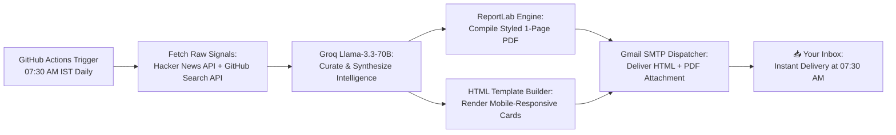

# ⚡ Morning Tech Pulse: Autonomous Daily Intelligence & System Design Agent

> An autonomous cloud-native AI agent that aggregates real-time engineering signals from Hacker News and GitHub APIs, curates executive technical digests using **Groq (Llama-3.3-70B)**, compiles styled multi-section PDFs, and delivers them directly to your email inbox every morning at **$0 compute cost**.

---

## 🏗️ Architecture & Daily Pipeline



### 4 Daily Executive Modules:
1. **📰 Top Engineering Breakthroughs**: 3 high-signal releases with *2-sentence summaries* and *💡 Why It Matters Technically* (focusing on system architecture, not marketing fluff).
2. **🛠️ GitHub Open-Source Gem of the Day**: High-utility repository with one-line pitch, terminal quickstart command, and practical use case.
3. **🧠 System Design Micro-Card**: Daily architectural pattern (Consistent Hashing, Raft, Write-Ahead Logs) with real-world case study (Discord, Netflix, Uber).
4. **💡 Terminal & Git Power-Tip**: 1-liner productivity command to sharpen your workflow.

---

## 🔒 Security & Privacy First

* **100% Private**: Runs via official Gmail SMTP over SSL (`smtp.gmail.com:465`).
* **Zero Third-Party Chat Access**: No QR codes, no linked devices, and no third-party access to your personal messages.
* **Native Delivery**: You receive a rich, color-coded HTML email body directly in your inbox, with `Morning_Tech_Pulse.pdf` attached for offline reading.

---

## 💰 Zero-Cost ($0) Stack

* **Inference**: Groq Cloud API (`llama-3.3-70b-versatile`) — Free tier (100k tokens/day).
* **Delivery**: Gmail SMTP (Built into Python `smtplib`) — Free (Standard Google Account).
* **Execution**: GitHub Actions CI/CD — Free (2,000 minutes/month).
* **PDF Compilation**: Python ReportLab — Free & Open Source.

---

## 🚀 4-Minute Setup Guide

### 1. Get Your Free Groq API Key (1 min)
1. Go to [console.groq.com](https://console.groq.com/) and sign up with Google/GitHub.
2. Navigate to **API Keys** → **Create API Key**.
3. Copy your key (starts with `gsk_...`).

### 2. Generate a Google App Password (2 mins)
1. Go to your [Google Account Security Settings](https://myaccount.google.com/security).
2. Ensure **2-Step Verification** is turned ON.
3. In the search bar at the top, type **"App passwords"** (or go to [myaccount.google.com/apppasswords](https://myaccount.google.com/apppasswords)).
4. Enter an app name: `Morning Tech Pulse` → Click **Create**.
5. Google will show a **16-character password** (e.g. `abcd efgh ijkl mnop`). Copy it!

### 3. Create GitHub Repository & Add Secrets (2 mins)
1. Create a new **private** repository on GitHub (e.g. `morning-tech-pulse`).
2. Push this folder to your repository:
   ```bash
   git init
   git add .
   git commit -m "feat: initial morning tech pulse agent"
   git branch -M main
   git remote add origin https://github.com/YOUR_USERNAME/morning-tech-pulse.git
   git push -u origin main
   ```
3. In your GitHub repo, go to **Settings → Secrets and variables → Actions** and click **New repository secret**:
   * `GROQ_API_KEY`: Your Groq API key (`gsk_...`)
   * `SENDER_EMAIL`: Your Gmail address (e.g. `you@gmail.com`)
   * `RECEIVER_EMAIL`: Where to send the email (e.g. `you@gmail.com`)
   * `GMAIL_APP_PASSWORD`: The 16-character Google App Password.

---

## 🧪 Testing Your Workflow

1. In your GitHub repository, click on the **Actions** tab.
2. Select **"Morning Tech Pulse Daily Dispatcher"** from the left sidebar.
3. Click the **"Run workflow"** button on the right.
4. Watch the runner finish in ~35 seconds; check your Gmail inbox — your **Morning Tech Pulse** briefing and attached PDF will arrive immediately!

---


