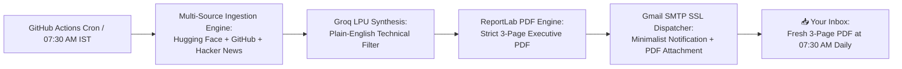
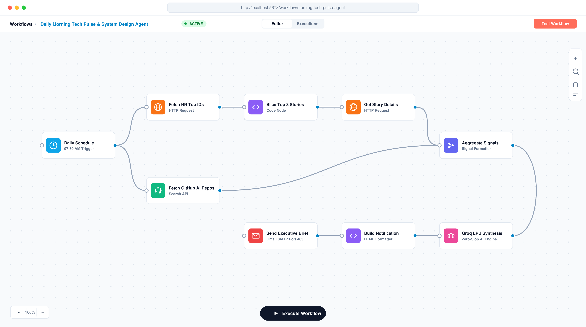
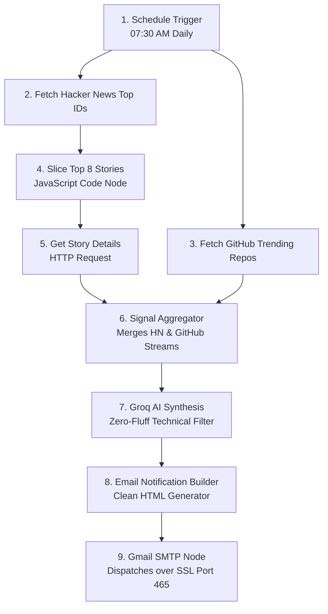

# ⚡ Morning Tech Pulse: Autonomous Daily AI & System Design Agent

> An autonomous cloud-native intelligence agent that crawls real-time developer signals across **Hugging Face**, **GitHub**, and **Hacker News**, distills technical breakthroughs with **Groq LPUs**, compiles a clean, book-grade **3-page executive PDF**, and delivers it straight to your inbox every morning at **$0 compute cost**.

---

## 💡 Why Morning Tech Pulse?

Staying updated as a developer is exhausting. Most tech newsletters are either 20-page walls of corporate marketing hype or dense academic research papers loaded with mathematical jargon that nobody has time to read before their morning standup.

**Morning Tech Pulse** was built to solve information overload:
* **Zero Marketing Fluff:** No buzzwords like *"game-changer"* or *"revolutionize"*. Just concrete facts, what was released, and why it matters to an engineer.
* **Beginner-Friendly & Intuitive:** Complex distributed systems (like distributed caching, rate limiting, and LSM trees) are explained using intuitive, memorable real-world analogies (like restaurant waiters and water buckets).
* **High-Signal 3-Page PDF:** Content is strictly organized across 3 dedicated pages with book-grade justified alignment, pure white editorial layout, and zero clutter.
* **100% Free & Automated ($0):** Runs entirely on free GitHub Actions CI/CD compute, free Groq LPU inference, and native Gmail SMTP with zero server hosting bills.

---

## 🏗️ Architecture & Daily Pipeline



---

## 🧩 Visual n8n Workflow (9-Node Pipeline)

The repository includes [daily_tech_pulse_n8n.json](daily_tech_pulse_n8n.json), a complete export of the visual drag-and-drop workflow. You can import this single JSON file directly into any **n8n** instance (Desktop, Docker, or Cloud):





### Breakdown of the 9 Nodes:
1. **Schedule Trigger:** Fires automatically every day at 07:30 AM IST (02:00 UTC).
2. **Fetch Hacker News Top Stories:** Queries Y Combinator's live Firebase API for breaking engineering discussions and post-mortems.
3. **Fetch Trending GitHub Repos:** Queries the GitHub REST API for actively growing open-source projects across Full Stack, DevOps, and Tools.
4. **Slice Top Stories:** A lightweight JavaScript Code node that batches story IDs.
5. **Get Story Details:** Retrieves story titles, URLs, and community score metrics.
6. **Signal Aggregator:** Combines disparate JSON streams into a single unified context for the LLM.
7. **Groq AI Synthesis:** Calls Groq's ultra-fast LPU inference to extract core breakthroughs, craft the daily System Design masterclass, and summarize developer repositories in plain English.
8. **Email Notification Builder:** Generates a clean, uncluttered email notification body with zero spoiler walls of text.
9. **Gmail SMTP Node:** Authenticates via a 16-character Google App Password and dispatches the email securely over SSL (`smtp.gmail.com:465`).

---

## 📄 What Arrives in Your Inbox: 3-Page Sample Breakdown

Every morning, you receive an email with **`Morning_Tech_Pulse.pdf`** attached. Each page is filled from top to bottom (~95% vertical utilization) with book-grade justified alignment:

```
┌───────────────────────────────────────────────────────────────┐
│ PAGE 1: DAILY AI BREAKTHROUGHS & LAB RELEASES                 │
│ • Concrete technical releases from OpenAI, DeepMind, Meta, etc│
│ • What was built, how it works in plain English, developer use│
├───────────────────────────────────────────────────────────────┤
│ PAGE 2: SYSTEM DESIGN MASTERCLASS (LEARNING TOPIC)            │
│ • The real-world problem (why databases crash under load)     │
│ • Intuitive mental model (restaurant waiter / bucket analogy) │
│ • Step-by-step request flow (Redis RAM check -> SQL -> TTL)   │
│ • Architectural trade-offs (cache invalidation, stampedes)    │
│ • Real production stories (Discord, Instagram, Netflix)       │
│ • Interview cheat sheet (what to say in engineering interviews)│
├───────────────────────────────────────────────────────────────┤
│ PAGE 3: STANDOUT DEVELOPER REPOSITORIES ACROSS TECH STACK     │
│ • 5 open-source projects (Full Stack, DevOps, Frontend, Tools)│
│ • What problem it solves, beginner overview & direct links    │
│ • Strictly zero terminal commands or code snippet clutter     │
└───────────────────────────────────────────────────────────────┘
```


---

## 💰 The Zero-Cost ($0) Stack

Morning Tech Pulse is designed with frugality and efficiency in mind:

| Layer | Service / Tool | Cost | Why We Chose It |
| :--- | :--- | :--- | :--- |
| **Orchestration** | **GitHub Actions** | **$0** (Free Tier) | 2,000 free runner minutes/month; replaces the need for a 24/7 paid VPS. |
| **Visual Workflow** | **n8n Workflow** | **$0** (Free & Open) | Visual low-code graph exportable as standard JSON (`daily_tech_pulse_n8n.json`). |
| **AI Inference** | **Groq Cloud API** | **$0** (Free Tier) | Ultra-fast LPU inference (500+ tokens/sec) with zero cost. |
| **Signal Ingestion** | **Hugging Face & GitHub APIs** | **$0** (Public) | Authentic real-time model releases, papers, and open-source trends. |
| **Document Engine** | **ReportLab (Python)** | **$0** (Open Source) | Programmatic, pixel-perfect PDF rendering with strict page budgeting. |
| **Delivery** | **Gmail SMTP** | **$0** (Standard Google) | Official SSL delivery (`port 465`) without third-party email marketing fees. |

---

## 🚀 4-Minute Setup Guide

You can have Morning Tech Pulse delivering to your own inbox in 4 quick steps:

### 1. Get Your Free Groq API Key (1 min)
1. Head over to [console.groq.com](https://console.groq.com/) and sign in with Google or GitHub.
2. Go to **API Keys** &rarr; click **Create API Key**.
3. Copy your key (starts with `gsk_...`).

### 2. Generate a 16-Character Google App Password (1 min)
1. Open your [Google Account Security Settings](https://myaccount.google.com/security).
2. Ensure **2-Step Verification** is enabled.
3. In the search box at the top, type **"App passwords"** (or visit [myaccount.google.com/apppasswords](https://myaccount.google.com/apppasswords)).
4. Enter `Morning Tech Pulse` &rarr; click **Create**.
5. Copy the 16-character code (e.g. `abcd efgh ijkl mnop`).

### 3. Add GitHub Repository Secrets (1 min)
In your forked or cloned repository on GitHub:
1. Navigate to **Settings &rarr; Secrets and variables &rarr; Actions**.
2. Click **New repository secret** and add these 4 variables:
   * `GROQ_API_KEY`: Your Groq key (`gsk_...`)
   * `SENDER_EMAIL`: Your Gmail address (e.g. `you@gmail.com`)
   * `RECEIVER_EMAIL`: Where to send the briefing (e.g. `you@gmail.com`)
   * `GMAIL_APP_PASSWORD`: The 16-character Google App Password.

### 4. Test Run (1 min)
1. Click the **Actions** tab in your GitHub repository.
2. Select **"Daily Morning Tech Pulse Cloud Dispatcher"** from the left menu.
3. Click **Run workflow** &rarr; **Run workflow**.
4. The workflow will complete in ~18 seconds. Check your Gmail inbox—your executive 3-page PDF is waiting for you!

---

## 🛠️ Local Development & Testing

Want to run the briefing locally on your computer?

```bash
# 1. Clone the repository
git clone https://github.com/vivek-kanugula/morning-tech-pulse.git
cd morning-tech-pulse

# 2. Install dependencies
pip install -r requirements.txt

# 3. Configure your local .env file
cp .env.example .env
# Edit .env with your GROQ_API_KEY, SENDER_EMAIL, RECEIVER_EMAIL, and GMAIL_APP_PASSWORD

# 4. Run the pipeline
python main.py
```

The script will ingest live signals, compile `Morning_Tech_Pulse.pdf`, and deliver it directly to your email inbox!

---

## 📜 License

Distributed under the **MIT License**. See [LICENSE](LICENSE) for more information. Built with curiosity and passion for clean, readable systems engineering.
